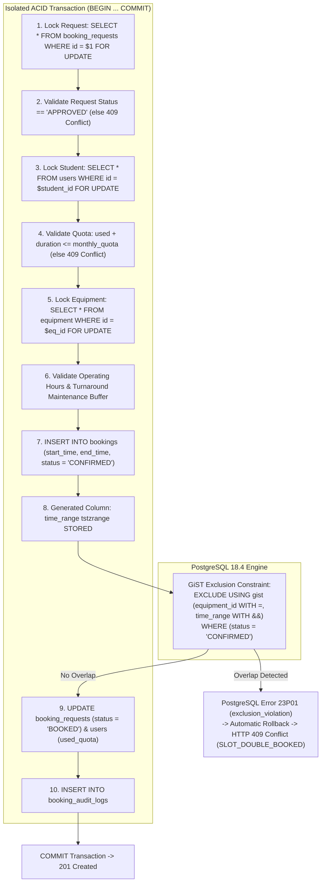
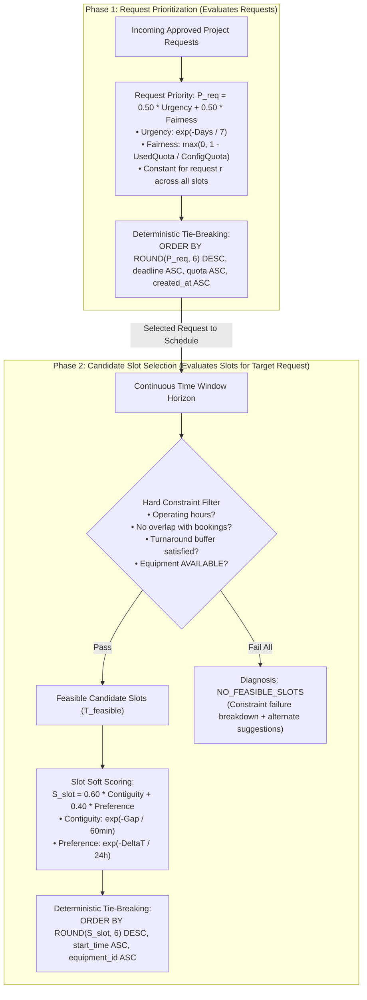

# LabLink 2026 - System Architecture & Engineering Design

**Project:** LabLink  
**Architecture Document Version:** 1.2.0 (Final Targeted Pre-Implementation Revision)  
**Target Environment:** Local Development (PostgreSQL 18.4) & Production (Google Cloud Run + Managed PostgreSQL)  
**Security Level:** Institutional Zero-Trust Server-Side RBAC  

---

## Document Revision History & Correction Log

| Version | Date | Author / Role | Key Revisions & Architectural Corrections |
|---|---|---|---|
| 1.0.0 | 2026-11-23 | Principal Architect | Initial baseline full-stack architecture specification. |
| 1.1.0 | 2026-11-23 | Principal Architect | Scope corrections for GiST exclusion (`WHERE status = 'CONFIRMED'`); client-controlled role prevention; two-stage workflow; Gemini sandboxing; Git $< 10$ MB strategy. |
| 1.2.0 | 2026-11-23 | Principal Architect | **Targeted Architectural Corrections:**<br>• Specified Firebase ID token verification strictly in server-side Node.js environment (`runtime = 'nodejs'`), explicitly avoiding Edge Middleware.<br>• Enforced database role resolution on every protected server operation.<br>• Adopted `GENERATED ALWAYS AS (tstzrange(start_time, end_time, '[)')) STORED NOT NULL` for `time_range`.<br>• Added pessimistic row locking on `booking_requests` and `users` (`FOR UPDATE`) to serialize confirmations and quota consumption.<br>• Separated Request Prioritization from Candidate Slot Selection in scheduling architecture.<br>• Made quotas and cancellation buffers configurable demo parameters; deferred access PIN tokens; identified minimal complete end-to-end workflow. |

---

## 1. High-Level System Architecture

LabLink is structured as a unified full-stack application built with **Next.js (App Router)** and **TypeScript**, packaged for containerized execution on **Google Cloud Run**.

The architecture enforces a strict separation of concerns across identity, persistence, deterministic scheduling, and semantic intelligence:

```mermaid
flowchart TB
    subgraph ClientTier["Client Tier (Browser & Responsive Mobile)"]
        UI_Student["Student Researcher Portal\n(Stitch Screens 01, 02, 05, 08)"]
        UI_Faculty["Faculty PI / Coordinator Console\n(Stitch Screens 03, 04, 06, 07, 09)"]
        FirebaseAuthClient["Firebase Auth Client SDK\n(Token Issuance & Refresh)"]
    end

    subgraph ServerTier["Application Tier (Next.js Node.js Server Environment)"]
        NodeAuthGuard["Node.js Auth & RBAC Guard\n(Firebase Admin SDK + PostgreSQL Role Check)"]
        
        subgraph APIRoutes["Next.js Route Handlers (app/api/v1/... - runtime: nodejs)"]
            AuthAPI["/api/v1/auth/sync\n(Strict Server-Controlled Role)"]
            EquipmentAPI["/api/v1/equipment\n(Catalog & Availability)"]
            RequestsAPI["/api/v1/requests\n(Docket Submission & Approval)"]
            BookingsAPI["/api/v1/bookings/confirm\n(Transactional GiST Commit)"]
            SchedulingAPI["/api/v1/scheduling\n(Recommendations & Conflicts)"]
            FacultyAPI["/api/v1/faculty\n(Lab & Asset Admin)"]
        end

        subgraph CoreServices["Domain Service Layer"]
            SchedulingEngine["Deterministic Scheduling Engine\n(Two-Phase: Request Priority & Slot Packing)"]
            GeminiService["Gemini AI Gateway\n(Advisory NLP & Explainability)"]
            AuditService["Immutable Audit Logger"]
        end
    end

    subgraph DataTier["Data & Cloud Intelligence Tier"]
        PostgresDB[("PostgreSQL 18.4 Engine\n• GiST Range Exclusion (tstzrange Generated)\n• Row Locks (FOR UPDATE)\n• ACID Transactions")]
        GeminiAPI["Google Gemini 2.5 Flash API\n(Explainability & Semantic NLP)"]
        FirebaseServer["Google Firebase Authentication\n(Identity & Public Key Verification)"]
    end

    UI_Student --> FirebaseAuthClient
    UI_Faculty --> FirebaseAuthClient
    FirebaseAuthClient -->|JWT ID Token in Header| NodeAuthGuard
    NodeAuthGuard -->|Decoded UID -> Query users.role| PostgresDB
    NodeAuthGuard -->|Authenticated Session| APIRoutes

    EquipmentAPI --> GeminiService
    RequestsAPI --> SchedulingEngine
    BookingsAPI --> PostgresDB
    SchedulingAPI --> SchedulingEngine
    SchedulingAPI --> GeminiService
    
    SchedulingEngine --> PostgresDB
    AuditService --> PostgresDB
    
    NodeAuthGuard -->|Verify Token Signature| FirebaseServer
    GeminiService -->|HTTPS REST (Advisory Only)| GeminiAPI
```

---

## 2. Authentication & Authorization Security Architecture

### 2.1 Server-Side Node.js Execution Boundary
- **Runtime Specification:** Next.js Edge Middleware runs in a restricted V8 isolate environment that does not support Node.js native cryptographic libraries (`crypto`, `http2`, `net`) required by the `firebase-admin` SDK.
- **Architectural Policy:** Token verification and database role authorization are executed exclusively within standard Node.js server environments (`export const runtime = 'nodejs'` in Route Handlers and Server Actions).
- **Middleware Role:** Next.js Edge Middleware (`middleware.ts`) is strictly limited to lightweight URL path matching, CORS headers, and presence checks for authorization headers or session cookies. It **does not** execute Firebase Admin token verification.
- **Node.js Auth Guard (`lib/auth/server-guard.ts`):** Every protected Route Handler invokes a shared `requireAuth(req, allowedRoles)` utility that:
  1. Extracts and verifies the Firebase ID token using `firebase-admin/auth`.
  2. Queries the local/production PostgreSQL `users` table:
     ```sql
     SELECT id, role, is_active, department_id, monthly_quota_hours, used_quota_hours 
     FROM users 
     WHERE firebase_uid = $1;
     ```
  3. Verifies that `is_active === true` and the internal database role matches `allowedRoles`.
  4. Client claims, custom claims, or client-provided role fields are never trusted for authorization.

### 2.2 Secure Account Synchronization (`POST /api/v1/auth/sync`)
The client payload can **never** dictate or modify user roles. Role elevation to `faculty` can only occur via pre-provisioned administrator seed records or through an authorized faculty member.

```typescript
// SECURE SYNCHRONIZATION LOGIC (Node.js Server-Side)
export async function handleAuthSync(req: Request) {
  // 1. Verify cryptographic token signature with Firebase Admin SDK
  const authUser = await verifyFirebaseToken(req);
  const email = authUser.email;
  const uid = authUser.uid;

  // 2. Query PostgreSQL to see if an account already exists or was pre-provisioned
  let user = await db.query('SELECT * FROM users WHERE email = $1', [email]);

  if (user) {
    // Account exists (or was pre-provisioned by admin) -> Bind firebase_uid if unset
    if (!user.firebase_uid) {
      await db.query('UPDATE users SET firebase_uid = $1 WHERE id = $2', [uid, user.id]);
    }
    // Return trusted record. Role is NEVER modified by client input.
    return NextResponse.json({ user: sanitizeUser(user) });
  }

  // 3. New unprovisioned user: STRICT DEFAULT TO STUDENT
  // Any client-provided role in the request body is explicitly discarded!
  const newUser = await db.query(
    `INSERT INTO users (firebase_uid, email, full_name, role, monthly_quota_hours, used_quota_hours, is_active)
     VALUES ($1, $2, $3, 'student', 25.0, 0.0, true)
     RETURNING *`,
    [uid, email, authUser.name || 'Student Researcher']
  );

  return NextResponse.json({ user: sanitizeUser(newUser) });
}
```

### 2.3 Seeded Demonstration Account Provisioning
To enable seamless evaluation without registration friction, two seeded demonstration accounts are provisioned via `npm run db:seed`:

| Account Role | Email Identifier | Initial Password | Internal PostgreSQL Role | Default Demo Quota |
|---|---|---|---|:---:|
| **Student Demo** | `student.demo@lablink.edu` | `DemoStudent2026!` | `student` | 25.0 Hours |
| **Faculty Demo** | `faculty.demo@lablink.edu` | `DemoFaculty2026!` | `faculty` | Unlimited |

The seed script utilizes the `firebase-admin/auth` SDK to ensure these accounts exist in the Firebase Auth project/emulator with matching UIDs pre-linked in the PostgreSQL `users` table. The login screen features a "Quick Login" button for evaluators that triggers standard client-side authentication.

---

## 3. Database Concurrency & Boundary Enforcement

Double-booking prevention is enforced through an airtight division between **database engine constraints** and **transactional application logic**:



### 3.1 Database-Enforced Storage Rules
1. **Generated Continuous Range:**
   ```sql
   time_range tstzrange GENERATED ALWAYS AS (tstzrange(start_time, end_time, '[)')) STORED NOT NULL
   ```
   Guarantees that `time_range` can never be null and never drifts from `start_time` and `end_time`.
2. **Physical Overlap Prevention:**
   ```sql
   CONSTRAINT no_overlapping_confirmed_bookings 
   EXCLUDE USING gist (
       equipment_id WITH =, 
       time_range WITH &&
   ) WHERE (status = 'CONFIRMED');
   ```
   Enforced at the storage engine level; rejects overlapping confirmed slots with SQLSTATE `23P01`.

### 3.2 Transactionally Enforced Application Rules
- **Request State Atomicity:** Request locked `FOR UPDATE` to guarantee that concurrent confirmation clicks cannot double-process a single request.
- **Quota Race Protection:** Student user row locked `FOR UPDATE` to guarantee that concurrent booking requests cannot exceed the student's monthly quota.
- **Operating Hours & Buffer Verification:** Evaluated against `laboratory_operating_hours` and adjacent bookings within the transaction before slot insertion.

---

## 4. Two-Phase Deterministic Scheduling Architecture

To eliminate mathematical confusion, the scheduling engine cleanly separates **Request Prioritization** from **Candidate Time-Slot Selection**:



### 4.1 Request Prioritization ($P_{\text{req}}(r)$)
- **Urgency ($U(r)$):** Proximity to milestone deadline ($D$ days). Missing deadline defaults to $U(r) = 0.10$.
- **Fairness ($F(r)$):** Remaining monthly student quota ($Q_{\text{config}}$). If quota is missing, safe default $Q_{\text{default}} = 25.0$h is used.
- *Crucial Property:* $P_{\text{req}}(r)$ is constant for request $r$ and is never used to rank time slots against each other.

### 4.2 Candidate Time-Slot Selection ($S_{\text{slot}}(t, e, r)$)
- **Hard Constraints (Independent Filter):** Prunes invalid intervals. If no slots are feasible, returns `STATUS: NO_FEASIBLE_SLOTS` with diagnostic constraint codes.
- **Soft Objectives (Feasible Slots Only):**
  - Contiguity / Schedule Packing ($S_{\text{contiguity}}$): Minimizes orphan idle gaps against existing bookings.
  - Student Window Preference ($S_{\text{preference}}$): Distance from student's requested time window.
- **Deterministic Ordering:** Pure relational sorting on `ROUND(S_slot, 6) DESC, start_time ASC, equipment_id ASC`.

---

## 5. End-to-End Workflow & Minimal Demonstrable Path

### 5.1 Smallest Complete End-to-End Demonstrable Workflow
For the PromptWars 2026 jury evaluation, the system provides an unbroken 7-step path:
1. **Authentication:** Sign in as Student Alex Chen via quick demo button.
2. **Equipment Discovery:** Filter and inspect the Keysight Oscilloscope on Screen 02.
3. **Request Submission:** Submit access request docket on Screen 05 with title, abstract, and duration.
4. **Faculty Review:** Sign in as Prof. Marcus Vance; review request on Screen 06; click "Approve Request".
5. **Slot Selection:** System displays feasible candidate slots ranked by contiguity and preference.
6. **Booking Confirmation:** Click "Confirm Booking"; commits slot under PostgreSQL GiST lock.
7. **Student Tracking:** Student views updated request docket on Screen 08 showing confirmed reservation.

---

## 6. Gemini GenAI Sandboxing & Security Guardrails

The Google Gemini API (`gemini-2.5-flash`) operates strictly within a **read-only advisory perimeter**:
- **Role:** Natural language equipment query parsing and human-readable explanation generation.
- **Strict Boundary:** Gemini executes zero SQL queries, cannot confirm bookings, cannot write to PostgreSQL, and cannot override constraints or user permissions.
- **Zod Validation:** All model outputs are parsed through strict Zod schemas on the Node.js server before use.

---

## 7. GitHub Submission Size & Asset Optimization Strategy

PromptWars 2026 mandates a public repository with exactly one branch (`master`) under **10 MB**.
- **Local Preservation:** All 13 original Stitch PNG screenshots (14.2 MB) and 18 high-resolution photos (1.8 MB) are preserved locally in `design/stitch/` and will never be deleted.
- **Git Exclusions:** `.gitignore` excludes `design/stitch/screens/*.png` and uncompressed camera assets.
- **Tracked Assets:** Semantic Tailwind HTML templates, design tokens, documentation, and compressed WebP/SVG assets ($< 500$ KB total). Total estimated repository size: **~3.2 MB**.
- **Pre-Commit Check:** `git count-objects -vH` verifies repository size is well below 10 MB.

---

## 8. Production Database Decision

**Neon Serverless PostgreSQL** is selected for competition demonstration due to zero idle cost, instant setup, built-in connection pooling (`-pooler`), and instant branch cloning. Google Cloud SQL remains documented as an enterprise production alternative.
