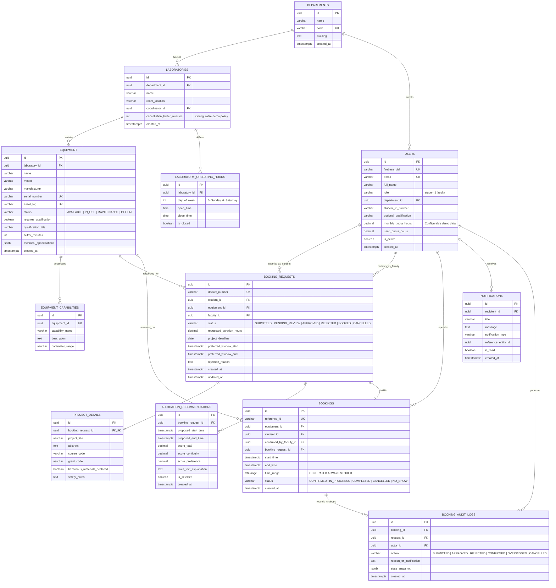

# LabLink 2026 - PostgreSQL 18.4 Database Schema & Concurrency Design

**Database Engine:** PostgreSQL 18.4 (Verified Local & Cloud Compatible)  
**Required Extensions:** `btree_gist`, `uuid-ossp`, `pgcrypto`  
**Concurrency Core:** GiST Range Exclusion (`EXCLUDE USING gist`) with `tstzrange` Generated Column  
**Document Version:** 1.2.0 (Final Targeted Pre-Implementation Revision)  

---

## Document Revision History & Correction Log

| Version | Date | Author / Role | Key Revisions & Architectural Corrections |
|---|---|---|---|
| 1.0.0 | 2026-11-23 | Principal Architect | Initial baseline schema design. |
| 1.1.0 | 2026-11-23 | Principal Architect | Scope corrections for GiST exclusion (`WHERE status = 'CONFIRMED'`); separation of DB vs transactional constraints. |
| 1.2.0 | 2026-11-23 | Principal Architect | **Targeted Architectural Corrections:**<br>• Enforced `time_range` consistency and non-nullability via `GENERATED ALWAYS AS (tstzrange(start_time, end_time, '[)')) STORED NOT NULL`.<br>• Added explicit row locking on `booking_requests` (`FOR UPDATE`) to prevent duplicate confirmations.<br>• Added explicit row locking on `users` (`FOR UPDATE`) to serialize quota consumption and prevent race conditions.<br>• Guaranteed complete atomicity across booking creation, request status transition, quota update, and audit logging.<br>• Made monthly quotas and cancellation buffers configurable demonstration parameters; removed deferred check-in PIN tokens.<br>• Documented rollback behavior and HTTP conflict mappings (`409 Conflict`). |

---

## 1. Concurrency Architecture & Constraint Division of Responsibility

LabLink avoids the common architectural pitfall of claiming a single database constraint enforces all scheduling rules. Instead, responsibility is partitioned with mathematical precision between the storage engine and isolated ACID transaction logic:

| Rule / Constraint | Enforced At | Enforcement Mechanism | Failure Response & Rollback Behavior |
|---|---|---|---|
| **Zero Overlapping Confirmed Bookings** | **Database Storage Engine** | `EXCLUDE USING gist (equipment_id WITH =, time_range WITH &&) WHERE (status = 'CONFIRMED')` on stored generated `time_range` column. | PostgreSQL raises `23P01 (exclusion_violation)`. Transaction automatically rolls back. Server returns HTTP `409 Conflict` (`SLOT_DOUBLE_BOOKED`). |
| **Non-Null, Consistent Time Intervals** | **Database Storage Engine** | `time_range tstzrange GENERATED ALWAYS AS (tstzrange(start_time, end_time, '[)')) STORED NOT NULL`, paired with `CHECK (end_time > start_time)`. | PostgreSQL raises `23514 (check_violation)`. Cannot be null or drift from timestamps. |
| **Prevent Duplicate Request Confirmation** | **Application Transaction Tier** | Pessimistic row lock: `SELECT id, status FROM booking_requests WHERE id = $1 FOR UPDATE`. | If `status != 'APPROVED'`, transaction aborts. Server returns HTTP `409 Conflict` (`REQUEST_ALREADY_PROCESSED`). |
| **Prevent Concurrent Quota Over-consumption** | **Application Transaction Tier** | Pessimistic row lock: `SELECT id, monthly_quota_hours, used_quota_hours FROM users WHERE id = $1 FOR UPDATE`. | If `(used_quota_hours + requested_hours) > monthly_quota_hours`, transaction aborts. Server returns HTTP `409 Conflict` (`QUOTA_EXCEEDED`). |
| **Facility Operating Hours (Open/Close)** | **Application Transaction Tier** | Evaluated against `laboratory_operating_hours` within transaction block. | Rejected with HTTP `422 Unprocessable Entity` (`OUTSIDE_OPERATING_HOURS`) before insert. |
| **Maintenance & Turnaround Buffers** | **Application Transaction Tier** | Scheduling engine verifies $t_{start} \ge \text{end}_{prev} + T_{buffer}$ and $t_{end} + T_{buffer} \le \text{start}_{next}$. | Infeasible slots pruned before confirmation attempt. |
| **Equipment Operational Status** | **Application Transaction Tier** | Row lock: `SELECT id, is_active, status FROM equipment WHERE id = $1 FOR UPDATE`. | Rejected with HTTP `400 Bad Request` if machine is `MAINTENANCE` or `OFFLINE`. |

---

## 2. Entity Relationship Diagram (Mermaid)



---

## 3. Data Dictionary & Detailed Table Definitions

### 3.1 `departments`
- `id` (UUID, Primary Key, `gen_random_uuid()`).
- `name` (VARCHAR(150), NOT NULL): Synthetic department name (e.g., "Central Engineering").
- `code` (VARCHAR(20), UNIQUE, NOT NULL): E.g., "ENG-CORE".
- `building` (TEXT, NOT NULL): E.g., "Engineering Hall 2".
- `created_at` (TIMESTAMPTZ, NOT NULL, DEFAULT NOW()).

### 3.2 `users`
- `id` (UUID, Primary Key, `gen_random_uuid()`).
- `firebase_uid` (VARCHAR(128), UNIQUE, NOT NULL): Cryptographic subject ID from Firebase Auth.
- `email` (VARCHAR(255), UNIQUE, NOT NULL): Institutional email address.
- `full_name` (VARCHAR(150), NOT NULL).
- `role` (VARCHAR(20), NOT NULL): `CHECK (role IN ('student', 'faculty'))`.
- `department_id` (UUID, References `departments(id)`, ON DELETE SET NULL).
- `student_id_number` (VARCHAR(50), NULL): Optional identifier.
- `optional_qualification` (VARCHAR(100), NULL): E.g., "Cleanroom Level 1". Configurable qualification, not mandatory.
- `monthly_quota_hours` (DECIMAL(5,2), NOT NULL, DEFAULT 25.00): Configurable demonstration parameter.
- `used_quota_hours` (DECIMAL(5,2), NOT NULL, DEFAULT 0.00): Accrued confirmed booking hours in current cycle.
- `is_active` (BOOLEAN, NOT NULL, DEFAULT TRUE).
- `created_at` (TIMESTAMPTZ, NOT NULL, DEFAULT NOW()).

### 3.3 `laboratories`
- `id` (UUID, Primary Key, `gen_random_uuid()`).
- `department_id` (UUID, NOT NULL, References `departments(id)`).
- `name` (VARCHAR(150), NOT NULL): E.g., "Advanced Prototyping and Robotics Lab".
- `room_location` (VARCHAR(50), NOT NULL): E.g., "Room B-104".
- `coordinator_id` (UUID, References `users(id)`).
- `cancellation_buffer_minutes` (INT, NOT NULL, DEFAULT 120): Configurable demonstration policy (default 120 min).
- `created_at` (TIMESTAMPTZ, NOT NULL, DEFAULT NOW()).

### 3.4 `laboratory_operating_hours`
- `id` (UUID, Primary Key, `gen_random_uuid()`).
- `laboratory_id` (UUID, NOT NULL, References `laboratories(id)` ON DELETE CASCADE).
- `day_of_week` (INT, NOT NULL): 0 (Sunday) to 6 (Saturday).
- `open_time` (TIME, NOT NULL, DEFAULT '08:00:00').
- `close_time` (TIME, NOT NULL, DEFAULT '20:00:00').
- `is_closed` (BOOLEAN, NOT NULL, DEFAULT FALSE).
- **Constraints:** `UNIQUE(laboratory_id, day_of_week)`, `CHECK (close_time > open_time)`.

### 3.5 `equipment`
- `id` (UUID, Primary Key, `gen_random_uuid()`).
- `laboratory_id` (UUID, NOT NULL, References `laboratories(id)`).
- `name` (VARCHAR(200), NOT NULL): E.g., "Keysight DSOX3024T Digital Storage Oscilloscope".
- `model` (VARCHAR(100), NOT NULL).
- `manufacturer` (VARCHAR(100), NOT NULL).
- `serial_number` (VARCHAR(100), UNIQUE, NOT NULL).
- `asset_tag` (VARCHAR(50), UNIQUE, NOT NULL): E.g., "EQ-LAB-1042".
- `status` (VARCHAR(30), NOT NULL, DEFAULT 'AVAILABLE'): `CHECK (status IN ('AVAILABLE', 'IN_USE', 'MAINTENANCE', 'OFFLINE'))`.
- `requires_qualification` (BOOLEAN, NOT NULL, DEFAULT FALSE): Optional equipment-level qualification gate.
- `qualification_title` (VARCHAR(100), NULL): Title of qualification if required.
- `buffer_minutes` (INT, NOT NULL, DEFAULT 15): Turnaround cool-down required between bookings.
- `technical_specifications` (JSONB, NOT NULL, DEFAULT '{}').
- `created_at` (TIMESTAMPTZ, NOT NULL, DEFAULT NOW()).

### 3.6 `equipment_capabilities`
- `id` (UUID, Primary Key, `gen_random_uuid()`).
- `equipment_id` (UUID, NOT NULL, References `equipment(id)` ON DELETE CASCADE).
- `capability_name` (VARCHAR(150), NOT NULL): E.g., "4-Channel 200MHz Real-Time Sampling".
- `description` (TEXT, NULL).
- `parameter_range` (VARCHAR(100), NULL).

### 3.7 `booking_requests`
- `id` (UUID, Primary Key, `gen_random_uuid()`).
- `docket_number` (VARCHAR(50), UNIQUE, NOT NULL): E.g., "REQ-2026-001".
- `student_id` (UUID, NOT NULL, References `users(id)`).
- `equipment_id` (UUID, NOT NULL, References `equipment(id)`).
- `faculty_id` (UUID, NOT NULL, References `users(id)`).
- `status` (VARCHAR(30), NOT NULL, DEFAULT 'SUBMITTED'): `CHECK (status IN ('SUBMITTED', 'PENDING_REVIEW', 'APPROVED', 'REJECTED', 'BOOKED', 'CANCELLED'))`.
- `requested_duration_hours` (DECIMAL(4,2), NOT NULL): `CHECK (requested_duration_hours >= 0.5 AND requested_duration_hours <= 12.0)`.
- `project_deadline` (DATE, NULL): Optional target delivery date.
- `preferred_window_start` (TIMESTAMPTZ, NULL).
- `preferred_window_end` (TIMESTAMPTZ, NULL).
- `rejection_reason` (TEXT, NULL): Mandatory explanation when status is `REJECTED`.
- `created_at` (TIMESTAMPTZ, NOT NULL, DEFAULT NOW()).
- `updated_at` (TIMESTAMPTZ, NOT NULL, DEFAULT NOW()).

### 3.8 `project_details`
- `id` (UUID, Primary Key, `gen_random_uuid()`).
- `booking_request_id` (UUID, UNIQUE, NOT NULL, References `booking_requests(id)` ON DELETE CASCADE).
- `project_title` (VARCHAR(255), NOT NULL).
- `abstract` (TEXT, NOT NULL).
- `course_code` (VARCHAR(50), NULL): E.g., "ENG-301".
- `grant_code` (VARCHAR(100), NULL): Optional research metadata.
- `hazardous_materials_declared` (BOOLEAN, NOT NULL, DEFAULT FALSE).
- `safety_notes` (TEXT, NULL).

### 3.9 `allocation_recommendations`
- `id` (UUID, Primary Key, `gen_random_uuid()`).
- `booking_request_id` (UUID, NOT NULL, References `booking_requests(id)` ON DELETE CASCADE).
- `proposed_start_time` (TIMESTAMPTZ, NOT NULL).
- `proposed_end_time` (TIMESTAMPTZ, NOT NULL).
- `score_total` (DECIMAL(7,6), NOT NULL): Normalized $0.000000$ to $1.000000$.
- `score_contiguity` (DECIMAL(7,6), NOT NULL): Schedule packing / gap score.
- `score_preference` (DECIMAL(7,6), NOT NULL): Alignment with requested window.
- `plain_text_explanation` (TEXT, NOT NULL): Human-readable justification.
- `is_selected` (BOOLEAN, NOT NULL, DEFAULT FALSE).
- `created_at` (TIMESTAMPTZ, NOT NULL, DEFAULT NOW()).

### 3.10 `bookings`
- `id` (UUID, Primary Key, `gen_random_uuid()`).
- `reference_id` (VARCHAR(50), UNIQUE, NOT NULL): E.g., "RES-84920".
- `equipment_id` (UUID, NOT NULL, References `equipment(id)`).
- `student_id` (UUID, NOT NULL, References `users(id)`).
- `confirmed_by_faculty_id` (UUID, NOT NULL, References `users(id)`).
- `booking_request_id` (UUID, NOT NULL, References `booking_requests(id)`).
- `start_time` (TIMESTAMPTZ, NOT NULL).
- `end_time` (TIMESTAMPTZ, NOT NULL).
- `time_range` (TSTZRANGE, GENERATED ALWAYS AS (tstzrange(start_time, end_time, '[)')) STORED NOT NULL).
- `status` (VARCHAR(30), NOT NULL, DEFAULT 'CONFIRMED'): `CHECK (status IN ('CONFIRMED', 'IN_PROGRESS', 'COMPLETED', 'CANCELLED', 'NO_SHOW'))`.
- `created_at` (TIMESTAMPTZ, NOT NULL, DEFAULT NOW()).
- **Constraints:**
  ```sql
  CONSTRAINT check_booking_positive_duration 
  CHECK (end_time > start_time),
  
  CONSTRAINT check_booking_duration_bounds 
  CHECK (end_time - start_time BETWEEN INTERVAL '30 minutes' AND INTERVAL '12 hours'),
  
  CONSTRAINT no_overlapping_confirmed_bookings 
  EXCLUDE USING gist (
      equipment_id WITH =, 
      time_range WITH &&
  ) WHERE (status = 'CONFIRMED');
  ```

### 3.11 `booking_audit_logs`
- `id` (UUID, Primary Key, `gen_random_uuid()`).
- `booking_id` (UUID, NULL, References `bookings(id)` ON DELETE SET NULL).
- `request_id` (UUID, NULL, References `booking_requests(id)` ON DELETE SET NULL).
- `actor_id` (UUID, NOT NULL, References `users(id)`).
- `action` (VARCHAR(50), NOT NULL): `SUBMITTED`, `APPROVED`, `REJECTED`, `CONFIRMED`, `OVERRIDDEN`, `CANCELLED`.
- `reason_or_justification` (TEXT, NOT NULL).
- `state_snapshot` (JSONB, NOT NULL).
- `created_at` (TIMESTAMPTZ, NOT NULL, DEFAULT NOW()).

### 3.12 `notifications`
- `id` (UUID, Primary Key, `gen_random_uuid()`).
- `recipient_id` (UUID, NOT NULL, References `users(id)` ON DELETE CASCADE).
- `title` (VARCHAR(200), NOT NULL).
- `message` (TEXT, NOT NULL).
- `notification_type` (VARCHAR(50), NOT NULL).
- `reference_entity_id` (UUID, NULL).
- `is_read` (BOOLEAN, NOT NULL, DEFAULT FALSE).
- `created_at` (TIMESTAMPTZ, NOT NULL, DEFAULT NOW()).

---

## 4. Complete Atomic Booking Confirmation Transaction Script

The following transactional sequence guarantees complete atomicity and prevents double-booking, duplicate confirmation, and quota over-consumption:

```sql
-- Step 1: Open isolated ACID transaction
BEGIN;

-- Step 2: Acquire pessimistic row lock on the project request
-- Guarantees that only ONE confirmation attempt can proceed for this request
SELECT id, status, student_id, equipment_id, requested_duration_hours
FROM booking_requests 
WHERE id = :request_id
FOR UPDATE;

-- Application Verification 2a: Validate request status
-- IF status != 'APPROVED' THEN
--   ROLLBACK;
--   RAISE EXCEPTION 'REQUEST_ALREADY_PROCESSED' USING ERRCODE = 'P0001';
--   (Server maps to HTTP 409 Conflict)

-- Step 3: Acquire pessimistic row lock on target equipment
SELECT id, is_active, status, buffer_minutes
FROM equipment 
WHERE id = :equipment_id AND is_active = TRUE
FOR UPDATE;

-- Application Verification 3a: Validate operational state
-- IF status != 'AVAILABLE' THEN
--   ROLLBACK;
--   RAISE EXCEPTION 'EQUIPMENT_NOT_AVAILABLE' USING ERRCODE = 'P0002';

-- Step 4: Acquire pessimistic row lock on student user record
-- Guarantees that concurrent transactions cannot consume quota past monthly allocation
SELECT id, monthly_quota_hours, used_quota_hours
FROM users 
WHERE id = :student_id
FOR UPDATE;

-- Application Verification 4a: Validate remaining quota
-- IF (used_quota_hours + :booking_duration_hours) > monthly_quota_hours THEN
--   ROLLBACK;
--   RAISE EXCEPTION 'QUOTA_EXCEEDED' USING ERRCODE = 'P0003';
--   (Server maps to HTTP 409 Conflict)

-- Step 5: Application validates operating hours and turnaround buffer against adjacent bookings
-- ...

-- Step 6: Insert confirmed booking
-- PostgreSQL GiST exclusion constraint on generated time_range guarantees no physical overlap
INSERT INTO bookings (
    id, reference_id, equipment_id, student_id, 
    confirmed_by_faculty_id, booking_request_id,
    start_time, end_time, status
) VALUES (
    gen_random_uuid(), :reference_id, :equipment_id, :student_id,
    :faculty_id, :request_id,
    :start_time, :end_time, 'CONFIRMED'
) RETURNING id, reference_id, time_range;

-- If GiST exclusion fires here, PostgreSQL raises SQLSTATE 23P01.
-- The transaction is automatically aborted, and server returns HTTP 409 Conflict (SLOT_DOUBLE_BOOKED).

-- Step 7: Update parent request status
UPDATE booking_requests 
SET status = 'BOOKED', updated_at = NOW() 
WHERE id = :request_id;

-- Step 8: Update student used quota hours
UPDATE users
SET used_quota_hours = used_quota_hours + :booking_duration_hours
WHERE id = :student_id;

-- Step 9: Insert immutable audit log entry
INSERT INTO booking_audit_logs (
    id, booking_id, request_id, actor_id, action, 
    reason_or_justification, state_snapshot
) VALUES (
    gen_random_uuid(), :new_booking_id, :request_id, :faculty_id, 'CONFIRMED',
    COALESCE(:faculty_justification, 'Standard faculty confirmation'),
    jsonb_build_object(
        'equipment_id', :equipment_id,
        'student_id', :student_id,
        'start_time', :start_time,
        'end_time', :end_time,
        'duration_hours', :booking_duration_hours
    )
);

-- Step 10: Commit transaction
COMMIT;
```

---

## 5. Rollback Behavior & HTTP Conflict Mapping

| Failure Condition | PostgreSQL Error Code / Condition | Application Error Code | HTTP Status | Client Message |
|---|---|---|:---:|---|
| Conflicting Confirmed Slot | `23P01 (exclusion_violation)` | `SLOT_DOUBLE_BOOKED` | **409 Conflict** | "The requested time slot conflicts with an existing confirmed booking." |
| Request Already Booked / Not Approved | Custom check on `booking_requests.status` | `REQUEST_ALREADY_PROCESSED` | **409 Conflict** | "This access request has already been processed or is not approved." |
| Student Quota Exceeded | Custom check on `users.used_quota_hours` | `QUOTA_EXCEEDED` | **409 Conflict** | "Student has reached their monthly allocation quota of laboratory hours." |
| Slot Outside Operating Hours | Application validation against schedule | `OUTSIDE_OPERATING_HOURS` | **422 Unprocessable** | "The proposed slot falls outside facility operating hours." |
| Insufficient Maintenance Buffer | Application validation against adjacent slots | `BUFFER_VIOLATION` | **422 Unprocessable** | "The slot does not provide the mandatory maintenance turnaround buffer." |

---

## 6. Concurrency Verification Test Specifications

1. **Simultaneous Booking Attempt Test (50 Threads):**
   - 50 concurrent asynchronous HTTP requests attempt to confirm the identical time slot on the identical instrument for 50 distinct approved requests.
   - *Verification:* Exactly 1 request succeeds with HTTP `201 Created`. Exactly 49 requests fail with HTTP `409 Conflict` (`SLOT_DOUBLE_BOOKED`). Zero database deadlocks occur.
2. **Concurrent Quota Race Condition Test (10 Threads):**
   - A student with 2.0 remaining quota hours initiates 10 concurrent booking requests of 1.0 hour each.
   - *Verification:* Exactly 2 requests succeed with HTTP `201 Created`. Exactly 8 requests fail with HTTP `409 Conflict` (`QUOTA_EXCEEDED`). The student's recorded `used_quota_hours` strictly equals their quota limit without over-allocation.
