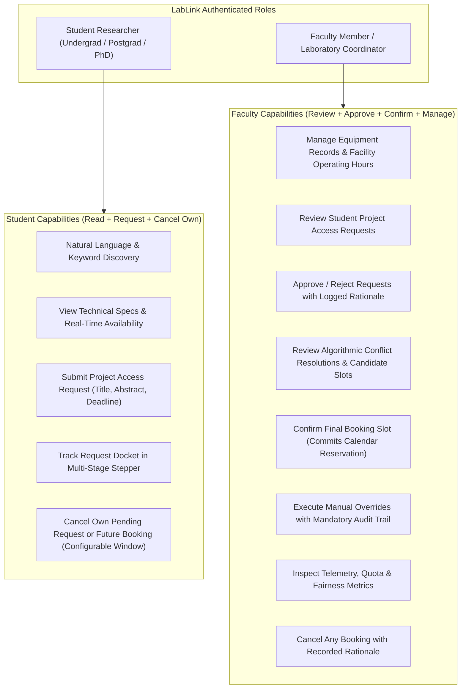
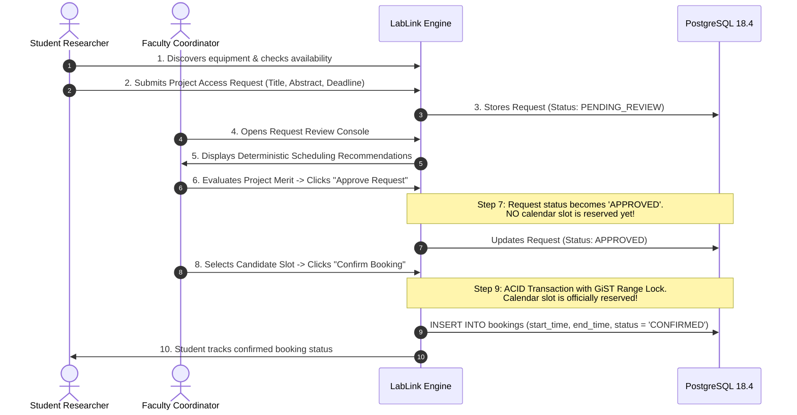

# LabLink 2026 - Product Requirements Document (PRD)

**Project Name:** LabLink  
**Project Title:** LabLink - Making College Laboratories More Accessible  
**Target Event:** PromptWars 2026  
**Document Version:** 1.2.0 (Final Targeted Pre-Implementation Revision)  
**Status:** Approved for Implementation Planning  

---

## Document Revision History & Correction Log

| Version | Date | Author / Role | Key Revisions & Architectural Corrections |
|---|---|---|---|
| 1.0.0 | 2026-11-23 | Principal Architect | Initial baseline PRD generated from Stitch designs and problem statement. |
| 1.1.0 | 2026-11-23 | Principal Architect | Enforced dual roles (`STUDENT`, `FACULTY`); made safety tiers optional; clarified two-stage request lifecycle; bounded scheduling score domains. |
| 1.2.0 | 2026-11-23 | Principal Architect | **Targeted Architectural Corrections:** • Formally separated Request Prioritization ($P_{\text{req}}$) from Candidate Time-Slot Selection ($S_{\text{slot}}$); urgency and fairness do not differentiate slots for the same request. • Separated hard constraint pruning completely from soft scoring. • Made monthly quotas and cancellation buffers configurable demonstration parameters. • Formally documented edge-case handling: missing deadlines, missing quotas, and zero-feasible-slot diagnostics. • Deferred physical/simulated access tokens from MVP. • Identified smallest complete end-to-end demonstrable workflow and framed estimates as non-binding guidance. |

---

## 1. Product Overview & Executive Summary

University research laboratories represent millions of dollars in advanced capital investments—including Field Emission Scanning Electron Microscopes (FE-SEMs), High-Performance Liquid Chromatographs (HPLCs), 3D bio-printers, and multi-axis CNC workstations. However, across academic departments, laboratory equipment remains severely under-utilized, isolated within departmental silos, and plagued by informal paper-based or ad-hoc email reservation systems.

**LabLink** is an institutional, AI-powered campus laboratory resource-sharing and intelligent scheduling platform engineered to democratize access to specialized experimental instrumentation, development kits, and workstations across university departments.

LabLink balances student project urgency with faculty oversight and facility operating constraints. Using a **deterministic constraint-aware scheduling engine** paired with the **Google Gemini API** for semantic requirement extraction and explainable arbitration, LabLink eliminates double bookings, optimizes equipment utilization, and guarantees transparent, equitable access.

---

## 2. Official Problem Statement Alignment

> **Official PromptWars 2026 Problem Statement:**  
> *"Create a GenAI-powered campus laboratory resource-sharing platform that helps students discover and access specialised equipment, development kits, and laboratory workstations across departments.*  
> *The platform should enable: (1) Equipment discovery, (2) Intelligent slot booking, (3) Project-based access requests, (4) Faculty approvals, (5) Resource utilisation optimisation, (6) Intelligent scheduling conflict resolution.*  
> *The platform should recommend fair and feasible equipment allocations based on: Project deadlines, Equipment availability, Student requirements, Requested duration, Laboratory operating hours, Scheduling constraints.*  
> *The goal is to improve laboratory accessibility and resource utilisation across university departments."*

---

## 3. Core Objectives & Key Results (OKRs)

### 3.1 Platform Objectives
1. **Universal Equipment Discovery:** Enable cross-departmental search across physical instrumentation, technical parameters, configurable prerequisites, and real-time operational health.
2. **Deterministic Constraint-Enforced Scheduling:** Provide mathematical guarantees against double-booking and operating-hour violations using PostgreSQL exclusion locks and transactional integrity.
3. **Project-Centric Governance:** Enforce academic accountability by tying every booking request to academic coursework, project abstracts, supervising faculty, and optional grant codes.
4. **Intelligent Conflict Arbitration:** When multiple researchers request concurrent access to exclusive instruments, resolve contention using a two-stage model: prioritizing requests by urgency and fairness, then packing feasible time slots to minimize schedule fragmentation.
5. **Explainable AI Integration:** Leverage the Google Gemini API to translate complex scheduling trade-offs into plain-language rationales for faculty review without granting the LLM direct mutation power over schedule state.

---

## 4. Target User Personas & Roles

LabLink strictly enforces **two primary authenticated roles**:

---

## 5. Workflow Distinction: Approval vs. Booking Confirmation

To prevent ambiguity, LabLink enforces an explicit separation between **Project Request Approval** and **Booking Slot Confirmation**:

- **Request Approval:** Faculty validates the project justification, safety declarations, and academic merit. This transitions the docket to `APPROVED`.
- **Booking Confirmation:** Faculty (or an automated trigger during review when a candidate slot is confirmed) commits the specific time slot to the calendar. This transitions the booking to `CONFIRMED` under the database exclusion lock.

---

## 6. Detailed Functional Requirements

### 6.1 Authentication & Session Management
- **FR-01 (Mandatory Authentication):** All protected routes require a valid Firebase Authentication session.
- **FR-02 (Authoritative Server-Side RBAC):** Firebase ID tokens are cryptographically verified in a standard Node.js server-side environment via Firebase Admin SDK. The user's role (`student` vs `faculty`) is resolved strictly from the PostgreSQL `users` table on **every** protected operation. Client claims or client-provided role fields are completely ignored.
- **FR-03 (No Self-Promotion):** Initial account synchronization defaults any unprovisioned user to `student`. Faculty accounts must be pre-provisioned or created by authorized faculty.
- **FR-04 (Demo Account Provisioning):** Seed scripts provision pre-configured demo credentials (`student.demo@lablink.edu`, `faculty.demo@lablink.edu`) linked to corresponding database records.

### 6.2 Equipment Discovery & Catalog
- **FR-05 (Multi-Faceted Search):** Users can filter equipment by department, category (Microscopy, Chromatography, 3D Fabrication, Robotics Workstations), operational status (`AVAILABLE`, `IN_USE`, `MAINTENANCE`, `OFFLINE`), and optional safety qualifications.
- **FR-06 (Natural-Language Semantic Query):** Users can search via free-form text. The Gemini API translates conversational queries into structured parameters without executing raw database queries.
- **FR-07 (Configurable Prerequisites):** If an instrument requires specific training, this is represented as a configurable equipment prerequisite, not a universal institutional barrier. In the competition demonstration, general instruments require no qualifications.

### 6.3 Project-Based Access Request Pipeline
- **FR-08 (Structured Docket Submission):** Students submit requests specifying:
  - Project title and abstract.
  - Optional grant code or course code (e.g., `MSE-401`).
  - Supervising faculty member.
  - Requested duration (hours) and preferred time windows.
  - Optional project deadline date.
- **FR-09 (Real-Time Docket Tracking):** Students track requests through a transparent multi-stage stepper (Submission -> Faculty Review -> Slot Confirmation).

### 6.4 Two-Stage Intelligent Scheduling & Conflict Resolution
The scheduling model is formally divided into two distinct, independent mathematical phases:

#### Phase 1: Request Prioritization ($P_{\text{req}}(r)$)
Evaluates which pending requests in the laboratory backlog should receive priority attention:
$$P_{\text{req}}(r) = w_u \cdot U(r) + w_f \cdot F(r)$$
- **Urgency ($U(r) \in [0.0, 1.0]$):** $U(r) = \exp(-D / \tau)$ where $D = \max(0, \text{deadline} - \text{now})$ and $\tau = 7.0$ days.
  - *Missing Deadline Handling:* If project deadline is omitted, the engine assigns a default baseline urgency $U(r) = 0.10$.
- **Fairness ($F(r) \in [0.0, 1.0]$):** $F(r) = \max(0.0, 1.0 - U_{\text{used}} / Q_{\text{config}})$.
  - *Configurable Quota:* $Q_{\text{config}}$ is a configurable demonstration parameter per user/department (default 25.0h). If missing or zero, the system enforces safe fallback $Q_{\text{default}} = 25.0$h, preventing division-by-zero.
- *Crucial Architectural Invariant:* $P_{\text{req}}(r)$ depends purely on request and student attributes; it is constant across all candidate time slots for request $r$ and is never used to compare one slot against another.

#### Phase 2: Candidate Time-Slot Selection ($S_{\text{slot}}(t, e, r)$)
1. **Hard Constraint Pruning (Strict Feasibility Filter):**
   Completely independent of soft scoring. A candidate slot $t = [t_{\text{start}}, t_{\text{end}}]$ is feasible ($t \in \mathcal{T}_{\text{feasible}}$) if and only if:
   - $[t_{\text{start}}, t_{\text{end}}] \subseteq [\text{open\_time}, \text{close\_time}]$ of the laboratory.
   - For all existing confirmed bookings $b$, $t \cap b = \emptyset$.
   - Maintenance turnaround buffer is satisfied: $t_{\text{start}} \ge \text{end}_{\text{prev}} + T_{\text{buffer}}$ and $t_{\text{end}} + T_{\text{buffer}} \le \text{start}_{\text{next}}$.
   - Equipment status is `AVAILABLE`.
   - Duration bounds: $t_{\text{end}} - t_{\text{start}} \in [0.5, 12.0]$ hours.
   - *Unavailable Candidate Slots Handling:* If $\mathcal{T}_{\text{feasible}} = \emptyset$, the engine returns `STATUS: NO_FEASIBLE_SLOTS`, provides a structured diagnostic of which hard constraints failed (`OUTSIDE_OPERATING_HOURS`, `BUFFER_VIOLATION`, `ALL_SLOTS_CONFLICTED`), and outputs recommended alternative windows outside the requested interval or compatible substitute equipment.
2. **Soft Scoring on Feasible Slots:**
   Feasible candidate slots are ranked by slot-specific packing and preference metrics:
   $$S_{\text{slot}}(t, e, r) = 0.60 \cdot S_{\text{contiguity}}(t, e) + 0.40 \cdot S_{\text{preference}}(t, r)$$
   - **Contiguity Score ($S_{\text{contiguity}} \in [0.0, 1.0]$):** Rewards slots that pack contiguously against existing bookings or operating boundaries ($G = \min(\text{gap}_{\text{prior}}, \text{gap}_{\text{subsequent}})$):
     $$S_{\text{contiguity}} = \exp\left(-\frac{G}{\lambda}\right), \quad \lambda = 60.0 \text{ minutes}$$
   - **Preference Score ($S_{\text{preference}} \in [0.0, 1.0]$):** Evaluates distance between $t$ and the student's preferred window center ($|\Delta t|$ in hours):
     $$S_{\text{preference}} = \exp\left(-\frac{|\Delta t|}{24.0}\right)$$
3. **Deterministic Tie-Breaking:**
   Exact relational tuple ordering without approximate epsilon comparisons:
   - For Request Priority: `(ROUND(P_req, 6) DESC, project_deadline ASC NULLS LAST, used_quota_hours ASC, created_at ASC, id ASC)`
   - For Slot Selection: `(ROUND(S_slot, 6) DESC, start_time ASC, end_time ASC, equipment_id ASC)`

### 6.5 Cancellation Policy
- **FR-11 (Student Cancellation):** Students can cancel their own pending requests at any time. Confirmed bookings can be cancelled by the student if prior to the laboratory's configurable cancellation buffer (`laboratory.cancellation_buffer_minutes`, default 120 minutes).
- **FR-12 (Faculty Cancellation):** Faculty coordinators can cancel any booking at any time, requiring a mandatory cancellation explanation that is logged and notified to the student.

---

## 7. Non-Functional Requirements (NFRs)

| ID | Category | Requirement Specification | Verification Metric |
|---|---|---|---|
| **NFR-01** | **Security** | Zero client-side role trust. Server-side verification on all Node.js route handlers. Generic error messages. | OWASP Top 10 compliance; 100% 403 on role escalation attempts. |
| **NFR-02** | **Data Integrity** | Zero double bookings under concurrent requests via PostgreSQL GiST exclusion on generated `time_range`. | Concurrent test with 50 simultaneous confirmation requests yields exactly 1 success. |
| **NFR-03** | **Performance** | API response times $< 200$ms for catalog filtering and scheduling calculations. | Core Web Vitals (LCP $< 1.8$s, CLS $< 0.05$). |
| **NFR-04** | **Accessibility** | Complete keyboard navigation, visible focus indicators, contrast ratio $\ge 4.5:1$. | WCAG 2.1 AA automated Lighthouse score $\ge 95$. |
| **NFR-05** | **Auditability** | Every booking approval, rejection, cancellation, and override logged immutably. | `booking_audit_logs` completeness validation. |
| **NFR-06** | **Competition Packaging** | Public repository, single `master` branch, repository size $< 10$ MB, Cloud Run ready. | `git count-objects -vH` $< 10$ MB. |

---

## 8. Competition MVP vs. Full Product Roadmap

### 8.1 Smallest Complete End-to-End Demonstrable Workflow
The minimum viable demonstration for competition evaluation comprises the following 7-step unbroken workflow:
1. **Authentication:** Seeded dual-role sign-in (Alex Chen [Student] / Prof. Marcus Vance [Faculty]).
2. **Equipment Discovery:** Filter and select an active instrument (Keysight Oscilloscope) on Screen 02.
3. **Access Request Submission:** Student completes and submits access request on Screen 05.
4. **Faculty Review:** Faculty reviews request merit on Screen 06 and clicks "Approve Request".
5. **Candidate Slot Selection:** System displays feasible candidate slots evaluated by contiguity and preference on Screen 04/06.
6. **Booking Confirmation:** Faculty commits slot, triggering PostgreSQL GiST exclusion lock in an ACID transaction.
7. **Student Tracking:** Student views updated request docket on Screen 08 showing confirmed status with timestamp.

*Implementation Time Notice: Estimated task hours in accompanying plans serve as architectural prioritization guidelines and do not constitute rigid completion guarantees.*

### 8.2 Prioritized Scope Breakdown

| Tier | Feature Scope | Target Deliverable | Deferrable Under Pressure? |
|---|---|---|:---:|
| **Priority 1 (Must Have - Competition Core)** | • Seeded dual-role Firebase authentication • Equipment discovery catalog with availability matrix • Project access request submission • Faculty request review (approval & rejection) • Booking confirmation with PostgreSQL GiST exclusion lock • Double-booking prevention guarantee • Student request tracking stepper | Minimum Viable Submission | **NO** (Core Integrity) |
| **Priority 2 (Should Have - Competition Excellence)** | • Deterministic multi-objective scheduling recommendations • Conflict detection & alternative candidate slot generator • Weekly scheduling calendar (Gantt view) • Faculty laboratory dashboard | Enhanced Submission | Partial (Fallback to rule-based slot picker) |
| **Priority 3 (Nice to Have - AI Polish & Cloud Packaging)** | • Gemini natural-language equipment query parsing • Gemini explainable arbitration text • Facility utilization analytics & quota gauges • Multi-stage Docker packaging for Cloud Run | Full Product Polish | **YES** (Can be stubbed/deferred) |
