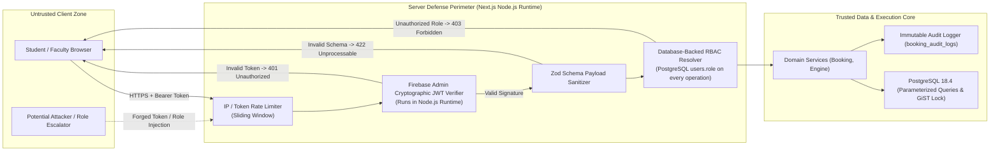

# LabLink 2026 - Security Architecture & Threat Mitigation Guide

**Security Classification:** Institutional Defense-in-Depth  
**Compliance Target:** OWASP Top 10 (2021), University Data Governance  
**Document Version:** 1.2.0 (Final Targeted Pre-Implementation Revision)  

---

## Document Revision History & Correction Log

| Version | Date | Author / Role | Key Revisions & Architectural Corrections |
|---|---|---|---|
| 1.0.0 | 2026-11-23 | Principal Architect | Initial baseline security design. |
| 1.1.0 | 2026-11-23 | Principal Architect | Role tampering elimination; Gemini sandboxing; concurrency exclusion error handling; `.gitignore` size rules. |
| 1.2.0 | 2026-11-23 | Principal Architect | **Targeted Architectural Corrections:**<br>• Enforced Firebase Admin token verification exclusively in server-side Node.js environment (`runtime = 'nodejs'`), explicitly prohibiting Edge Middleware execution.<br>• Mandated internal PostgreSQL role verification on every protected operation.<br>• Formalized transactional locking against duplicate confirmations (`booking_requests` `FOR UPDATE`) and concurrent quota exhaustion (`users` `FOR UPDATE`).<br>• Documented secure demo account provisioning protocol. |

---

## 1. Zero-Trust Security Architecture Overview

LabLink operates under an institutional **Zero-Trust Security Architecture**. The frontend UI is treated as completely untrusted. All security boundaries, role verifications, constraint validations, and state mutations are enforced **exclusively on the server in a Node.js runtime**.



---

## 2. Authentication & Account Security

### 2.1 Node.js Server Environment Execution
- **Runtime Restriction:** Next.js Edge Middleware runs in a restricted V8 isolate that does not support Node.js native cryptographic libraries (`crypto`, `http2`, `net`) required by `firebase-admin`.
- **Architectural Policy:** Token verification and database role resolution are executed exclusively in Node.js Route Handlers (`app/api/v1/**/route.ts` with `export const runtime = 'nodejs'`).
- **Every Protected Operation:**
  1. The server extracts the `Authorization: Bearer <ID_TOKEN>` header.
  2. Verifies token cryptographically using `firebaseAdmin.auth().verifyIdToken(token)`.
  3. Queries PostgreSQL directly:
     ```sql
     SELECT id, role, is_active, monthly_quota_hours, used_quota_hours 
     FROM users 
     WHERE firebase_uid = $1;
     ```
  4. Client claims, custom claims, or client-provided role fields are **never** trusted for authorization.

### 2.2 Complete Elimination of Role Self-Promotion (`POST /api/v1/auth/sync`)
> [!CAUTION]
> **Vulnerability Elimination:** In insecure applications, a user synchronization endpoint accepts a client-provided `role` field, allowing an attacker to send `{"role": "faculty"}` and escalate their privileges.
> **LabLink Security Rule:** The client payload can **never** dictate or modify user roles.

```typescript
// SECURE SYNCHRONIZATION ENDPOINT (Node.js Server-Side)
export async function POST(req: Request) {
  // 1. Cryptographically verify token in Node.js environment
  const token = req.headers.get('Authorization')?.replace('Bearer ', '');
  if (!token) return NextResponse.json({ error: 'TOKEN_MISSING' }, { status: 401 });
  
  const decodedToken = await firebaseAdmin.auth().verifyIdToken(token);
  const email = decodedToken.email;
  const uid = decodedToken.uid;

  // 2. Query trusted database record
  let user = await db.query('SELECT * FROM users WHERE email = $1', [email]);

  if (user) {
    // Existing record: Bind UID if missing, but NEVER alter role based on request body
    if (!user.firebase_uid) {
      await db.query('UPDATE users SET firebase_uid = $1 WHERE id = $2', [uid, user.id]);
    }
    return NextResponse.json({ user: sanitizeUser(user) });
  }

  // 3. New unprovisioned user: STRICT DEFAULT TO 'student'
  // Any role passed by the client is explicitly discarded
  const newUser = await db.query(
    `INSERT INTO users (firebase_uid, email, full_name, role, monthly_quota_hours, used_quota_hours, is_active)
     VALUES ($1, $2, $3, 'student', 25.0, 0.0, true)
     RETURNING *`,
    [uid, email, decodedToken.name || 'Student Researcher']
  );

  return NextResponse.json({ user: sanitizeUser(newUser) });
}
```

### 2.3 Trusted Demo Account Provisioning
To enable zero-friction evaluation by the competition jury without bypassing authentication:
1. Seed script (`scripts/seed.ts`) uses `firebase-admin/auth` to pre-create:
   - `student.demo@lablink.edu` (Password: `DemoStudent2026!`, Role: `student`, Quota: 25.0h)
   - `faculty.demo@lablink.edu` (Password: `DemoFaculty2026!`, Role: `faculty`, Quota: Unlimited)
2. Corresponding records are created in PostgreSQL with matching `firebase_uid` values.
3. The login interface provides quick-login buttons that call legitimate Firebase Auth client SDK sign-in routines.

---

## 3. Database Concurrency & Race Condition Defense

### 3.1 PostgreSQL GiST Exclusion Constraint on Generated Column
Double-booking is prevented at the database storage engine layer:
```sql
-- Generated column ensures time_range cannot be null and matches timestamps exactly
time_range tstzrange GENERATED ALWAYS AS (tstzrange(start_time, end_time, '[)')) STORED NOT NULL,

-- Exclusion constraint enforces zero overlapping confirmed bookings
CONSTRAINT no_overlapping_confirmed_bookings 
EXCLUDE USING gist (
    equipment_id WITH =, 
    time_range WITH &&
) WHERE (status = 'CONFIRMED');
```

### 3.2 Pessimistic Row Locking for State & Quota Integrity
To defend against concurrency race conditions beyond slot overlap:
1. **Duplicate Confirmation Defense:** The request docket is locked during confirmation (`SELECT * FROM booking_requests WHERE id = $1 FOR UPDATE`). If status is already `BOOKED`, the transaction immediately aborts and returns HTTP `409 Conflict` (`REQUEST_ALREADY_PROCESSED`).
2. **Quota Race Defense:** The student user row is locked during confirmation (`SELECT * FROM users WHERE id = $student_id FOR UPDATE`). If `(used_quota_hours + duration) > monthly_quota_hours`, the transaction aborts and returns HTTP `409 Conflict` (`QUOTA_EXCEEDED`).

### 3.3 Concurrency Error Handling
When PostgreSQL raises error code `23P01` (`exclusion_violation`), the server intercepts the exception and returns:
```json
{
  "error": "SLOT_DOUBLE_BOOKED",
  "message": "The requested time slot conflicts with an existing confirmed booking."
}
```
HTTP status code: **409 Conflict**.

---

## 4. Gemini GenAI Sandboxing & Threat Defense

The Google Gemini API is strictly confined to an **advisory sandbox**:

| Threat Vector | Mitigation Strategy |
|---|---|
| **Prompt Injection via Search Queries** | Search queries are sanitized and passed as explicit data variables within structured prompt templates. Gemini system instructions disallow role assumption or instruction overrides. |
| **Model Output Hallucination / Malformed JSON** | Every structured JSON response from Gemini is strictly validated against a server-side Zod schema. If validation fails, the system safely falls back to standard PostgreSQL trigram keyword search. |
| **Unauthorized State Mutation** | Gemini has **zero database write access** and zero API endpoints to confirm bookings. All database mutations require authenticated human user action. |
| **Information Leakage in Explanations** | Gemini prompt templates only receive public instrument metadata and the specific student request docket. No student grades, personal IDs, or private passwords are ever sent to the model. |

---

## 5. Secrets Management & Repository Size Protection

### 5.1 Environment Variable Isolation
- **Server-Only Secrets:** `GEMINI_API_KEY`, `FIREBASE_ADMIN_PRIVATE_KEY`, `DATABASE_URL` reside strictly on the server and are never prefixed with `NEXT_PUBLIC_`.
- **Production Secrets:** Injected via Google Secret Manager in Cloud Run; zero secrets stored in Docker image layers or GitHub commits.

### 5.2 Strict `.gitignore` Rules & Size Compliance
To satisfy the PromptWars 2026 repository size limit ($< 10$ MB), raw high-resolution design exports are kept local:

```gitignore
# Dependencies & Build
node_modules/
.next/
out/

# Environment Secrets
.env*
!.env.example
*.pem
service-account*.json

# Repository Size Protection: Keep raw Stitch screenshots local
design/stitch/screens/*.png
design/stitch/assets/*.png

# Retain semantic HTML templates, tokens, and metadata in Git
!design/stitch/screens/*.html
!design/stitch/design-tokens/*
!design/stitch/manifest.json
```

---

## 6. Audit Logging & Non-Repudiation

All critical operations are logged to the immutable `booking_audit_logs` table:

```typescript
export async function logAuditEvent({
  bookingId,
  requestId,
  actorId,
  action,
  reason,
  stateSnapshot
}: AuditLogParams) {
  await db.query(
    `INSERT INTO booking_audit_logs (booking_id, request_id, actor_id, action, reason_or_justification, state_snapshot)
     VALUES ($1, $2, $3, $4, $5, $6)`,
    [bookingId, requestId, actorId, action, reason, JSON.stringify(stateSnapshot)]
  );
}
```

Events audited include: `REQUEST_SUBMITTED`, `FACULTY_APPROVED`, `FACULTY_REJECTED`, `BOOKING_CONFIRMED`, `FACULTY_OVERRIDDEN`, `BOOKING_CANCELLED`.
